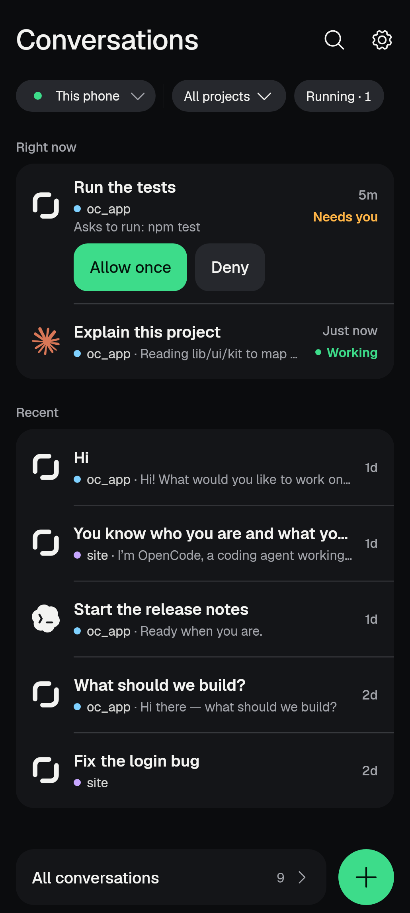
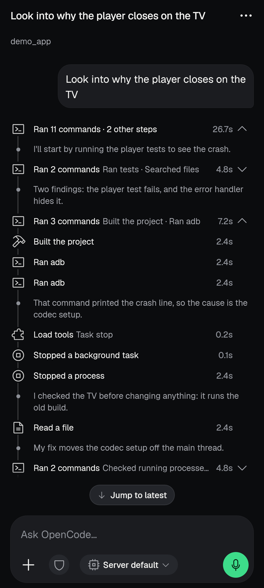

# OpenCode Mobile

An Android app for running and steering AI coding agents on your phone or your own computer.

| Home and approvals | Conversation steps |
| :---: | :---: |
|  |  |

## What you can do

- **Run agents on your phone.** Built-in Ubuntu Linux runs OpenCode 2, Claude Code, Codex and more inside the app, without Termux.
- **Connect to your computer.** Pair with OpenCode 2, or connect to Codex or Paseo over your local network or Tailscale.
- **Approve work from anywhere.** Review commands and edits, then allow or deny from chat, Home, notifications or home-screen widgets.
- **Steer while it works.** Send a follow-up mid-task, switch models, dictate with on-device voice typing, or keep Plan mode read-only.
- **Review diffs, files and Git.** Inspect changes line by line, browse allowed project folders, commit with Git and use the built-in terminal.
- **Preview apps and schedule prompts.** Open a local dev server inside the app, attach screenshots, and run one-off or repeating prompts.

Agents on this phone: OpenCode 2 (free models included), Claude Code, Codex, Antigravity, Qwen Code, Kilo, Cline, Goose, Oh My Pi and fx.

## Install

1. On Android 8.0 or newer (64-bit), download the `arm64-v8a` APK (or universal; `x86_64` is for emulators) from the [latest release](https://github.com/Eslamasabry/opencode-mobile-next/releases/latest).
2. Open the APK on your phone and allow Android to install apps from that source.
3. Update later through **Settings > This app > Updates** or by installing a newer APK from [Releases](https://github.com/Eslamasabry/opencode-mobile-next/releases).

Public releases share signing certificate `842284B27AA297FB74CF831779FD16498517E1BC2104451459FEC2EA7AC11D1C` (check in **Settings > About**) and update 2.1 and 3.0 in place; do not uninstall to fix an update, or on-phone projects are deleted.

## First run

1. Pick **On this phone** (needs 1,800 MB RAM and about 210 MB on Wi-Fi), **On my computer**, or **Just show me** for an offline demo.
2. Let on-phone setup finish and name a project, or run `opencode2 pair` on your computer (OpenCode 2 only) and scan or paste the code.
3. Choose an agent and model and send your first prompt; OpenCode's free models need no key, or add your own in **Settings**.

## Privacy

- Your conversations and code go only to the servers you choose. Passwords stay in Android Keystore, and voice dictation uses on-device speech models.
- Optional usage (Google Firebase, Umami on Railway) and crash reports are off until you enable them; neither sends prompts, files or keys.
- Problem reports send only when you tap **Send**; update checks query GitHub and missing provider logos load from models.dev. See [PRIVACY.md](PRIVACY.md).

## For developers

```bash
cd native
./gradlew -p build-logic test       # module rules
./gradlew :<module>:desktopTest     # one module's common tests
./gradlew :quality:test             # architecture rules and graph smoke
./gradlew :androidApp:assembleDebug # preview APK
```

Native Kotlin code lives in [`native/`](native/) (JDK 21, JDK 17, Android SDK `platforms;android-37.1`): see [CONTRIBUTING.md](CONTRIBUTING.md), [native/AGENTS.md](native/AGENTS.md) and [AGENTS.md](AGENTS.md); 2.x Flutter code is at tag `flutter-final`.

## Help and feedback

Use [GitHub Issues](https://github.com/Eslamasabry/opencode-mobile-next/issues) (read [SUPPORT.md](SUPPORT.md) first), [Discussions](https://github.com/Eslamasabry/opencode-mobile-next/discussions), [Security Advisories](https://github.com/Eslamasabry/opencode-mobile-next/security/advisories/new) ([SECURITY.md](SECURITY.md)), or see [v3.0.2 release notes](docs/releases/v3.0.2+10150.md).

## License

[MIT License](LICENSE), third-party notices in [THIRD_PARTY_NOTICES.md](THIRD_PARTY_NOTICES.md). OpenCode Mobile is an independent community project, not built, maintained, endorsed by, or affiliated with the official OpenCode team, Anthropic, OpenAI or Google.
