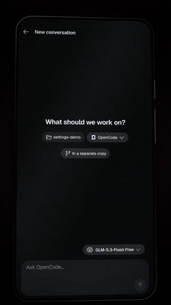
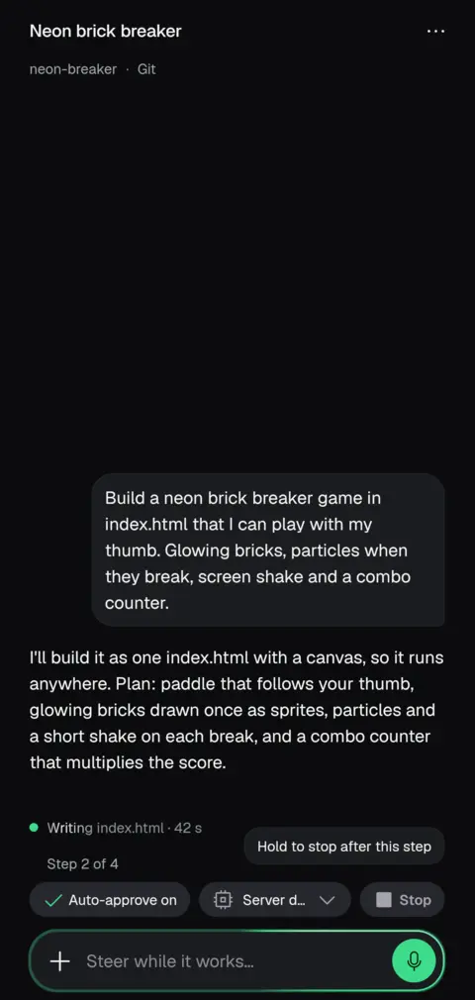
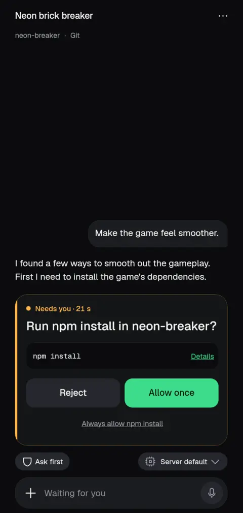
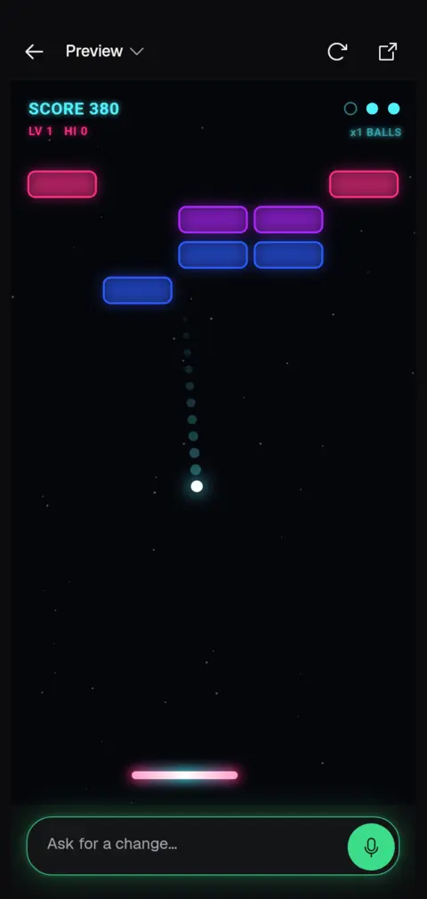
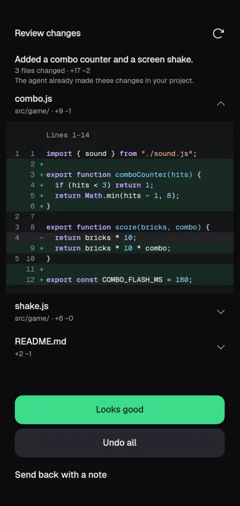
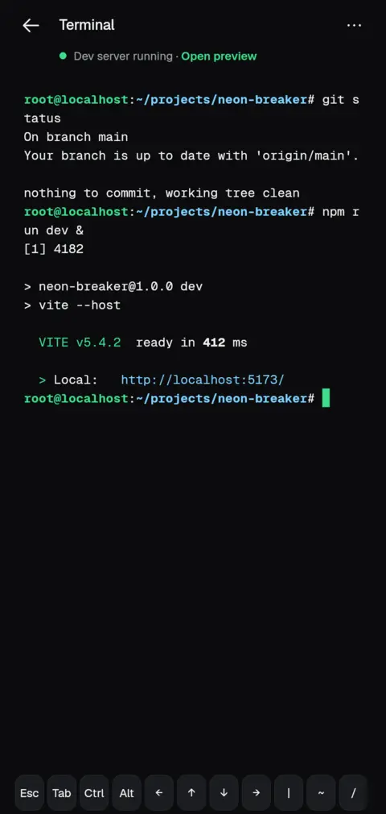
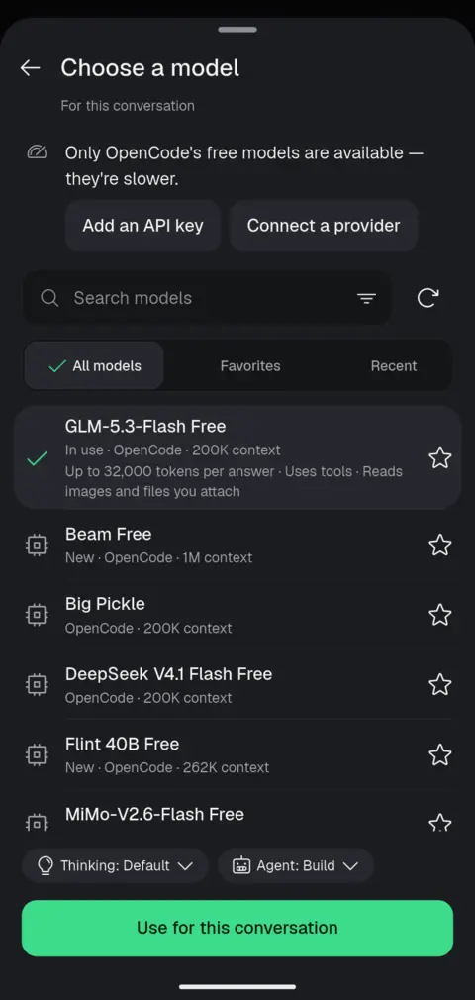
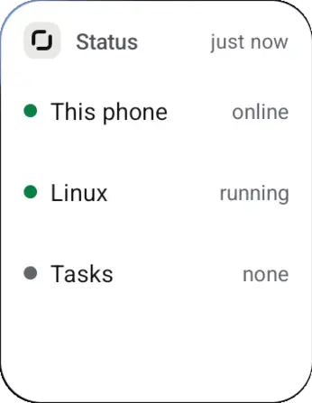

<div align="center">


# OpenCode Mobile

**Coding agents on your Android phone.**
Ten agents, including Claude Code, Codex, Gemini CLI, Qwen Code, Kilo, Cline, Goose and OpenCode, in a Linux the app installs itself.
No computer, no Termux. Or connect to the agent on your computer.

[](https://github.com/Eslamasabry/opencode-mobile-next/releases/latest)
[](https://github.com/Eslamasabry/opencode-mobile-next/releases)
[](https://github.com/Eslamasabry/opencode-mobile-next/actions/workflows/android-quality.yml)
[](LICENSE)

**[Download for Android](https://github.com/Eslamasabry/opencode-mobile-next/releases/latest)**
&nbsp;·&nbsp; [Website](https://eslamasabry.github.io/opencode-mobile-next/)
&nbsp;·&nbsp; [Get it on Obtainium](https://apps.obtainium.imranr.dev/redirect?r=obtainium://add/https://github.com/Eslamasabry/opencode-mobile-next)
&nbsp;·&nbsp; [What's new in 2.0](docs/releases/v2.0.0+56.md)

<a href="https://eslamasabry.github.io/opencode-mobile-next/assets/video/launch-720.mp4">
  
</a>

<sub>**[Watch the one-minute demo (mp4)](https://eslamasabry.github.io/opencode-mobile-next/assets/video/launch-720.mp4)**, also on the [website](https://eslamasabry.github.io/opencode-mobile-next/): one prompt builds a game, it runs in the app's preview, a screenshot goes back into the chat, and the agent adds power-ups.</sub>

</div>

---

## Why

- Coding agents keep working while you are away from your desk, and they stop to ask. A phone is where that question reaches you.
- Setting up a Linux and an agent by hand on a phone takes a lot of steps. The app does them for you and keeps the agent inside the app.
- Everything stays open: MIT license, your own servers and keys, no hosted service in between.

## How it compares

AndCode facts come from its public README, checked 2026-10-31; the Termux column is general. They change; check the source before relying on them.

| | OpenCode Mobile | Termux + an agent CLI | [AndCode](https://github.com/yuga-hashimoto/and-code) |
| --- | --- | --- | --- |
| What it is | Android app with chat, diff, terminal and widgets | Terminal emulator and Linux environment; the agent is a command-line tool you install | Android GUI app for coding agents |
| Agents on the phone | Ten: Claude Code, Codex, Gemini CLI, Qwen Code, Kilo, Cline, Goose, Oh My Pi, fx, OpenCode | Whichever agent CLI you install and can run | OpenCode, Claude Code, Google Antigravity, Codex |
| Linux setup | Guided in-app install of Ubuntu, Git and Node | By hand, in a terminal | Guided in-app install through PRoot (Alpine; Debian for Antigravity) |
| Connect to a computer | OpenCode 2, Codex, or Claude Code through Paseo | Over SSH, by hand | Remote OpenCode |
| Approve a command from a notification or widget | Yes | Depends on the agent CLI | Tool approvals in the app |
| Scheduled prompts | Yes | With your own tools (such as cron) | Yes |
| License | MIT | See the Termux repository; agent licenses vary | MIT |

OpenCode Mobile is a younger project and several of its agents are less tested on real phones; see [Compatibility](#compatibility).

## Highlights

- **Ten agents, one app.** Pick Claude Code, Codex, Gemini CLI, Qwen Code, Kilo, Cline, Goose, Oh My Pi, fx or OpenCode for each conversation. Claude Code and OpenCode are the best proven on a phone; the others are newer. OpenCode's free models work without an API key.
- **Real Linux on the phone.** The app installs its own Ubuntu with Git and Node, runs the agent there, and keeps your projects inside the app. A full terminal is built in.
- **Approve from anywhere.** Allow or reject a command from the notification, the home-screen widget or the chat, or turn on auto-approve and let it run.
- **Steer mid-task.** Send a new instruction while the agent works, instead of waiting for it to finish.
- **See the result.** Open the agent's dev server in the in-app preview, then send a screenshot back into the chat.
- **Review every line.** A phone-sized diff, change by change, before anything is committed.
- **Scheduled prompts.** Run a prompt at a time you choose, once or repeating, even with the app closed.
- **Widgets in five sizes.** See what your agents are doing and act on requests from the home screen.
- **Private by design.** The app talks only to servers you choose. Voice is transcribed on the phone.

## Screens

| Ask | Approve | Play it | Review |
| :---: | :---: | :---: | :---: |
|  |  |  |  |

| Terminal | Models | Home-screen widget |
| :---: | :---: | :---: |
|  |  |  |

All screens are real captures from the app.

## Get started

**You need** an Android phone running Android 8 or newer. Running agents on the phone itself needs a 64-bit phone. Bring a model provider, or start with OpenCode's free models.

1. **Install.** Download the APK from the [latest release](https://github.com/Eslamasabry/opencode-mobile-next/releases/latest). Most phones want the `arm64-v8a` file; the universal APK works everywhere. Android asks you to allow installs from outside the Play Store.
2. **Choose where your agent runs.**
   - **On this phone:** follow the guided setup. The first run downloads Ubuntu and the tools, about 210 MB, so use Wi-Fi.
   - **On my computer:** run `opencode2 pair` on the computer and scan the QR code, or enter its address. [Tailscale](https://tailscale.com) lets you reach it from anywhere.
   - **Just show me:** a simulated conversation, no server needed.
3. **Start a conversation.** Pick an agent and a model and describe the change. Add your own provider key in Settings when you want more than the free models.

Coming from Termux? **Move from Termux** copies your projects into the app. More help is in [SUPPORT.md](SUPPORT.md) and the in-app guide.

## Compatibility

| | Status |
| --- | --- |
| Android | 8 or newer; on-phone agents need a 64-bit phone |
| OpenCode | OpenCode 2 only; OpenCode 1 is no longer supported |
| Claude Code, Codex, Gemini CLI, Qwen Code, Kilo, Cline, Goose, Oh My Pi, fx | On the phone, in the built-in Linux (newer ones are less tested on real phones) |
| Agents on your computer | OpenCode 2, Codex directly, or Claude Code through [Paseo](https://github.com/getpaseo/paseo) |
| Languages | English and Arabic, with partial Spanish, Japanese, Portuguese, Russian and Chinese |
| Linux and Windows desktop | Experimental builds |
| iOS and macOS | Not available |

## Updating

Android updates an app in place only when the new APK has the same signature. Public releases are signed with

```
842284B27AA297FB74CF831779FD16498517E1BC2104451459FEC2EA7AC11D1C
```

so each release installs over the previous one and keeps your servers, sign-ins and settings. You can check the installed signer in **Settings → About**. Do not uninstall to fix a failed update: projects on the phone live inside the app and would be deleted.

## Privacy

The app connects only to the servers you choose. Passwords stay in Android's keystore, voice is transcribed on the device, and diagnostics leave the phone only when you send a report yourself, with secrets removed. See [PRIVACY.md](PRIVACY.md).

## Development

The app is Flutter with native Android parts in Kotlin. Start with:

- [docs/technical-overview.md](docs/technical-overview.md): architecture, server protocols, building and releasing
- [CONTRIBUTING.md](CONTRIBUTING.md): the pinned toolchain, checks and code boundaries
- [AGENTS.md](AGENTS.md): working notes for coding agents in this repo
- [SECURITY.md](SECURITY.md): report vulnerabilities privately

```bash
flutter pub get
flutter analyze
tool/qa/run_tests_fast.sh    # the full suite in parallel shards
```

CI runs analysis, Android lint, the test suite in six shards and a signed release build.

## License

[MIT](LICENSE). Bundled fonts, models and packages are listed in [THIRD_PARTY_NOTICES.md](THIRD_PARTY_NOTICES.md).

OpenCode Mobile is an independent community project. It is not built, maintained, endorsed by, or affiliated with the official OpenCode team. It is not affiliated with Anthropic. It was built with substantial AI assistance. Thanks to the OpenCode team for the agent this app is a window onto.
