# OpenCode Mobile — illustrated changelog

From installed **1.1.0+2159** to candidate **APK 2199**, `feat/genui-fe` at `f0443a349`. Before images come from `8b261aad3` (2026-10-06).

Existing app goldens and QA captures illustrate the supplied changes. Light theme is preferred; dark images are used where they are the available evidence. Captions identify synthetic fixtures, older QA builds and limits of what a still can show. Matching base images are included for changed layouts when available; identical images are not duplicated. These pictures are not a fresh runtime or release qualification.

Images are cropped or masked to remove accounts, codes, private paths and computer labels, then saved as JPEG at quality 80 and no more than 720 pixels wide. Setup comparisons assemble two existing screenshot crops per image. No app tests, builds, installs, sign-ins or removals were performed for this document.

## Claude Code on the phone

- Claude's model chip no longer gets stuck on "Loading conversation selection".

  (no screenshot: no existing image captures this Claude selection fix.)

- Claude's sub-agents show as sub-agent cards and open as their own read-only conversations.

  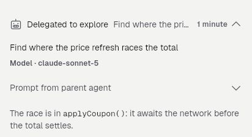

  Existing sub-agent card layout; this generic fixture does not show the new Claude routing or the read-only child conversation. Source: [golden](../../../test/revamp/goldens/chat_tool_subagent_step_light.png), unchanged from the base.

- Claude's conversations stay live in the list when its helper starts slowly; its helper starts with the app.

  (no screenshot: no existing capture shows the slow-helper or startup sequence.)

- Agent rows say "Signed in as &lt;account&gt;" only after a real sign-in check; Sign out on the agent's sheet.

  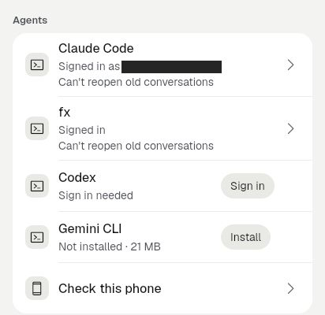
  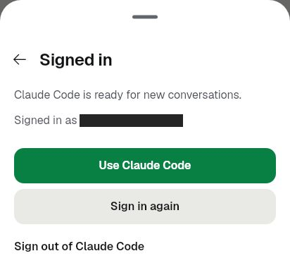

  Signed-in row and Sign out sheet; fixture account masked. These goldens illustrate the UI, not a live authentication check. Sources: [row golden](../../../test/goldens/agents_account_row_light.png), [sheet golden](../../../test/goldens/agents_account_sheet_light.png).

- Agents that need sign-in say so instead of "Checking sign-in…" forever (#95); sign-in has Open sign-in page and Copy code.

  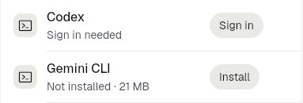
  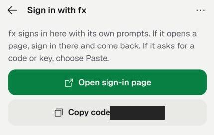

  Sign-in-needed row and the two sign-in buttons; one-time code masked and terminal cropped away. Sources: [row golden](../../../test/goldens/agents_account_row_light.png), [FA1 historical QA](../../../docs/qa/fa1-sign-in-buttons-2026-10-07/after-fx-terminal.jpg).

- The app stays alive while you sign in to an agent in the browser.

  (no screenshot: no existing capture demonstrates the browser round trip; signing in was outside this capture task.)

- Install / Sign in as short chips on agent rows.

  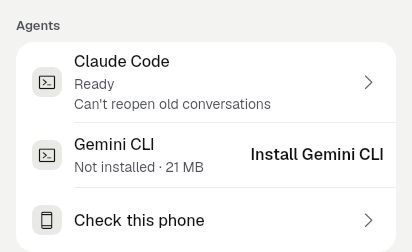
  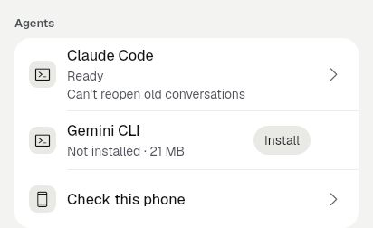

  Before at `8b261aad3` → candidate: Install becomes a short chip; Sign in is visible in the row image above. Source: [same golden](../../../test/goldens/agents_settings_agents_light.png) at the base and candidate revisions.

- New: Remove an installed agent from its sheet; shows the space freed; accounts and chats stay.

  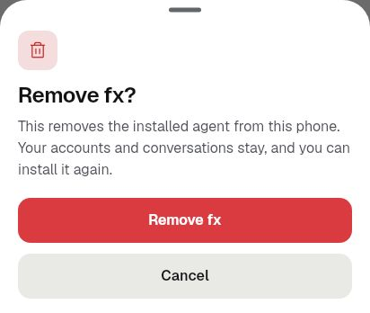
  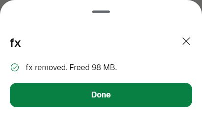

  Confirmation explains retained accounts and conversations; the result shows freed space (golden fixtures, not a device removal). Sources: [confirmation golden](../../../test/goldens/agents_remove_confirm_light.png), [result golden](../../../test/goldens/agents_remove_done_light.png).

- Six agents verified to install, cancel and retry; storage check counts download plus unpacked size.

  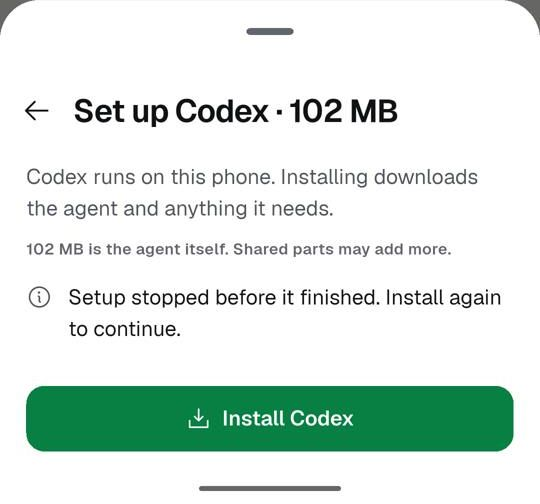
  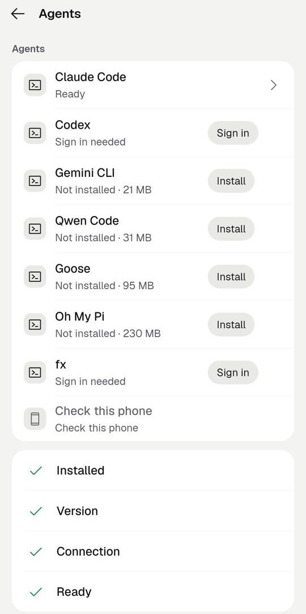

  Historical APK 2196 example: cancelled Codex install and successful retry/check; the six-agent and storage evidence is described in the source report. Sources: [cancel QA](../../../docs/qa/FQ-install-2026-10-08/codex-cancelled.jpg), [installed QA](../../../docs/qa/FQ-install-2026-10-08/codex-after-install-check.jpg), [qualification report](../../../docs/qa/FQ-install-2026-10-08/README.md).

## Conversations list

- Loads by itself after start, switch or reconnect — no pull needed.

  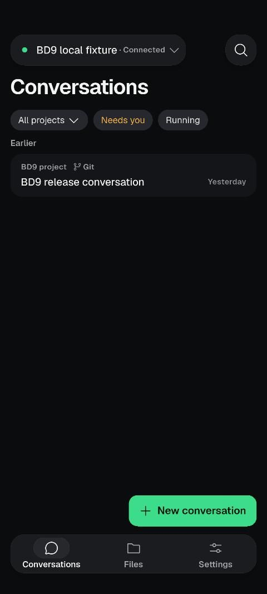

  Existing emulator proof with a synthetic conversation loaded before any gesture (QA version-code override 2201, not APK 2199; source `fe7052de0` is included in the candidate); source: [BD2 capture](../../../docs/qa/bd2-2026-10-07/conversations.jpg), [qualification notes](../../../docs/qa/bd2-2026-10-07/README.md#final-device-qualification--pass-2026-10-08).

- Answer a waiting request (Allow once, Always allow, Reject) right in the list, with Undo.

  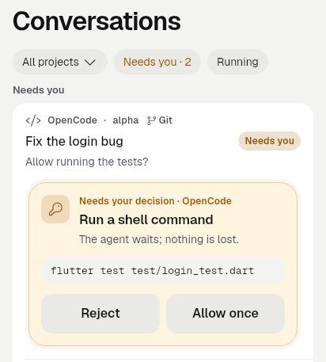
  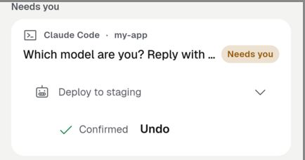

  Allow once and Reject in a list golden; separate historical agent-card Undo example (APK 2171); Always allow is not pictured. Sources: [list golden](../../../test/goldens/agent_card_list_mixed_light.png), [agent-card QA capture](../../../docs/qa/agent-cards-2026-10-07/proof-2171.png).

- "Done" marks finished runs on every server until opened.

  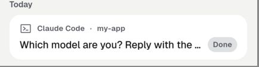

  Historical Claude conversation with Done (APK 2171); this image illustrates the badge, not every-server coverage or its dismissal. Source: [agent-card QA capture](../../../docs/qa/agent-cards-2026-10-07/proof-2171.png).

- An unreachable server is named ("Termux isn't answering") with Try again.

  (no screenshot: no existing capture of this list state found.)

- Other servers' conversations show at once after a restart; a row being opened says "Opening…".

  (no screenshot: no existing capture of the restored multi-server list or Opening state found.)

## Chat

- New: Agent cards — choices, forms, tables, charts and photo asks, answered in chat or in the list.

  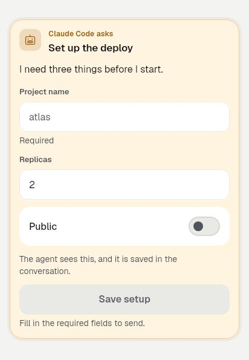
  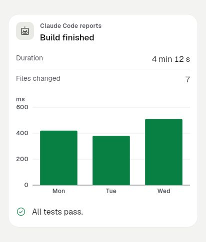

  Light-theme form and report goldens; list choices appear above, while table and photo asks are not pictured. Sources: [form golden](../../../test/goldens/agent_card_chat_form_light.png), [report golden](../../../test/goldens/agent_card_chat_report_light.png); neither golden existed at the base commit.

- Clearer stopped, stall and live lines; plain tool names; one spinner when steps are open.

  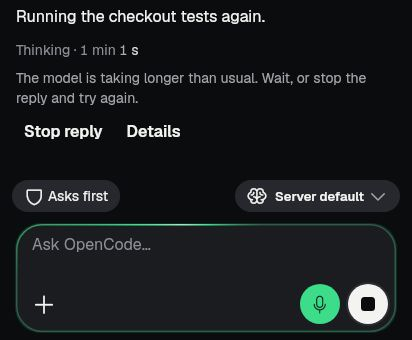
  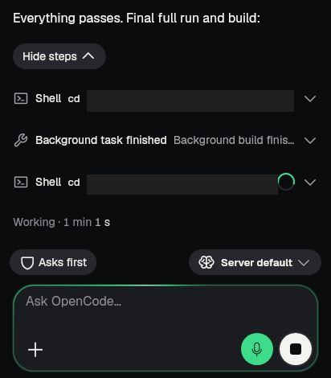

  Stall wording and expanded work in real ChatScreen fixtures; private-path regions masked, stopped-end wording not pictured. Sources: [stall capture](../../../docs/qa/chat-turn-fixes-2026-10-08/after-stalled.png), [expanded-work capture](../../../docs/qa/chat-turn-fixes-2026-10-08/after-work-expanded.png).

- Photo thumbnails for images you send; model names show at once and are remembered per server.

  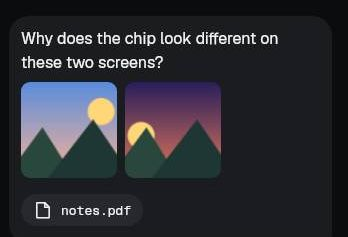
  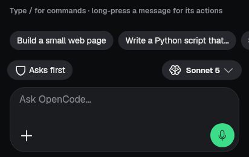

  Generated sample photos and Sonnet 5 before the catalog loads; persistence across restarts is not pictured. Sources: [photo QA capture](../../../docs/qa/FC4-2026-10-07/after-sent-photos.jpg), [model-chip QA capture](../../../docs/qa/FC5-2026-10-07/after-model-chip-crop.jpg).

- Approval-mode chip on the composer; numbered lists start at the right number; one $ per command.

  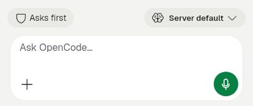
  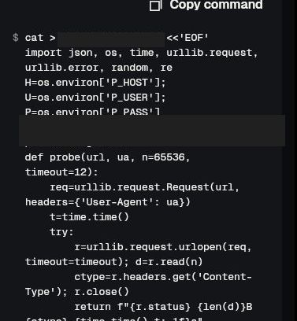

  Approval chip and multiline-command prompt; fixture-path lines masked, numbered-list offsets not pictured. Sources: [approval golden](../../../test/goldens/chat_approval_ask_light.png) (identical at base commit), [command QA capture](../../../docs/qa/command-block-2026-10-07/after-wrapped.jpg).

## Switching and connections

- A switch or reconnect shows once, in the server pill, with calm wording and a counting timer.

  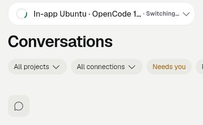

  Caption: The switching state appears in the server pill; this still does not demonstrate the timer advancing. Source: [light golden](../../../test/goldens/runtime_switch_reconnecting_light.png), cropped to the header. No matching golden exists at `8b261aad3`.

## Background and stability

- A crashed in-app server restarts by itself (3 tries); it comes back after Android closes the app.

  (no screenshot: automatic recovery and the three-attempt limit have no dedicated visual capture; reproducing a crash or closing the shared runtime is outside this screenshot-only session.)

- A failed update rolls back to the last working version; stale "check running" records no longer block installs or Remove.

  (no screenshot: rollback and stale-record recovery are internal transitions without a dedicated existing image; an ordinary install or Remove screen would not demonstrate either fix.)

- "Paused to save battery" notice with Resume.

  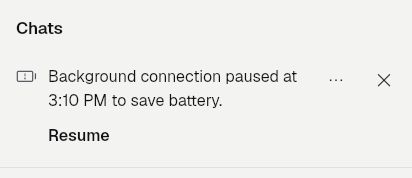

  Caption: A compact battery-pause notice offers Resume. Source: [light golden](../../../test/goldens/background_pause_time_limit_light.png), cropped above fixture conversation and computer names. No matching golden exists at `8b261aad3`.

## Diagnostics

- New: Recent app exits — crashes and app-not-responding first.

  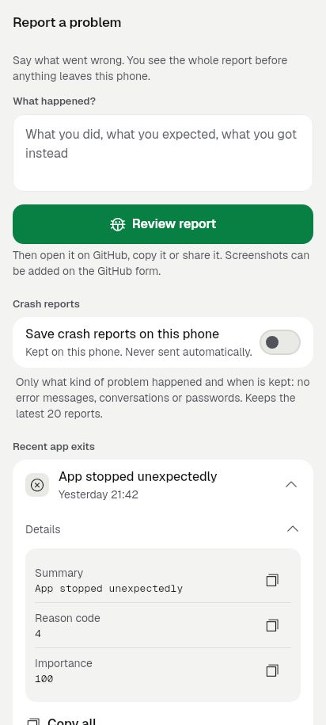

  Caption: Unexpected exits appear first, with details for a crash and routine closes folded below. Source: [light golden](../../../test/revamp/goldens/exit_history_one_open_light.png). No matching golden exists at `8b261aad3`.

- Opt-in saved crash reports with a preview of exactly what Share sends.

  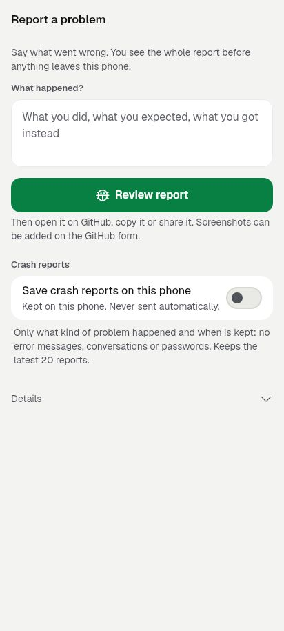
  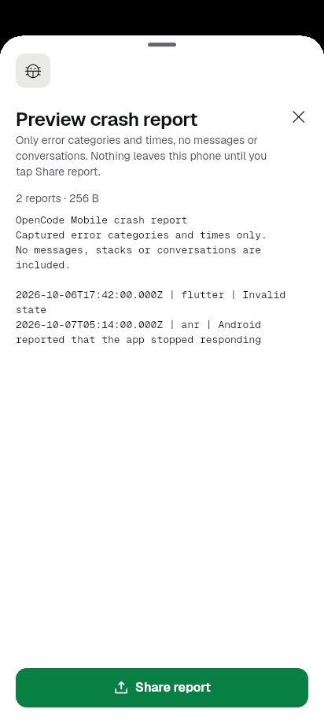

  Caption: Saving starts off; the share preview shows the exact report text, with synthetic categories and times only. Sources: [consent golden](../../../test/revamp/goldens/crash_reports_off_light.png), [share-preview golden](../../../test/revamp/goldens/crash_report_share_preview_light.png). Neither image exists at `8b261aad3`.

## Languages

- Arabic complete; Japanese, Chinese, Spanish, Portuguese and Russian for first run and chat.

  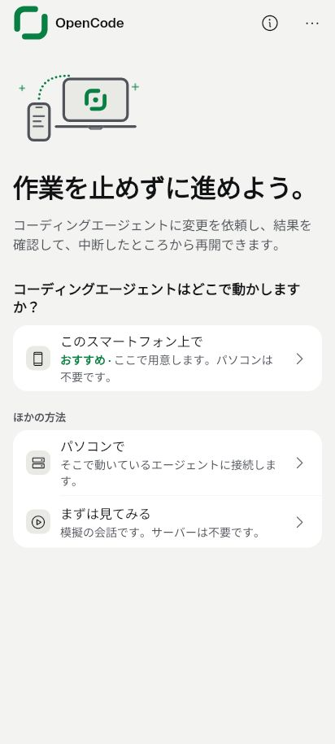

  Japanese first run, one example of the five added languages; existing light golden, not a device capture. Source: [languages_welcome_ja_light.png](../../../test/goldens/languages_welcome_ja_light.png).

  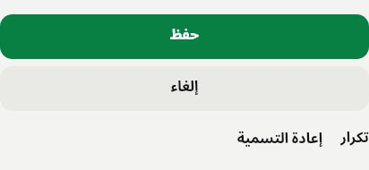

  Arabic right-to-left action controls; cropped component golden illustrates translated labels, not whole-app translation coverage. Source: [kit_action_block_default_ar_light.png](../../../test/goldens/kit/kit_action_block_default_ar_light.png).

- An unsupported phone language falls back to English (was Arabic).

  (no screenshot: no existing capture exercises an unsupported phone language; static language-picker images cannot show the fallback.)

- Android notifications follow the app language.

  (no screenshot: existing notification-localization evidence is code/test output, with no native notification capture; the device language was left unchanged.)

## Settings

- Tools is one page with tabs; voice licences in About; 27 → 23 pages.

  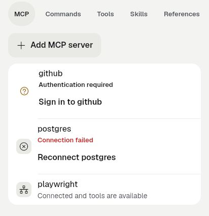

  Tools brings MCP and the catalog tabs together; crop removes the fixture computer label and resource URI. Source: [fg6_tools_mcp_light.png](../../../test/revamp/goldens/fg6_tools_mcp_light.png).

  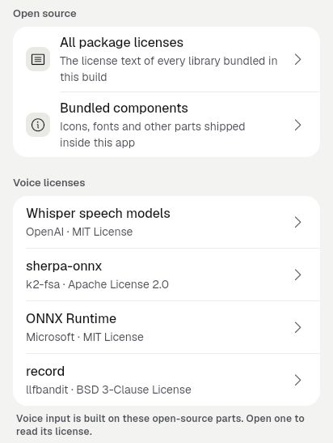

  About holds Voice licenses below Open source; cropped existing light golden. Source: [fg6_about_loaded_light.png](../../../test/revamp/goldens/fg6_about_loaded_light.png). The [page-count evidence](../../qa/fg6-2026-10-08/README.md) records 27 → 23; a screenshot does not establish that count.

## Setup and store

- Phone option marked Recommended, with a step line ("about 4 min").

  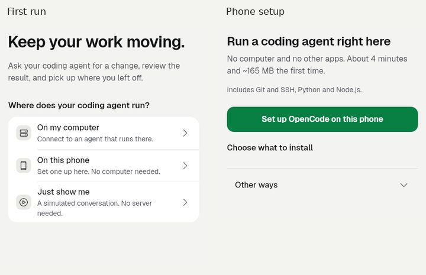

  Before at `8b261aad3`: assembled crops of the existing first-run (left) and setup (right) screenshots. Sources: `git show 8b261aad3:test/goldens/servers_welcome_light.png`, `git show 8b261aad3:test/revamp/goldens/phone_setup_start_fresh_light.png`.

  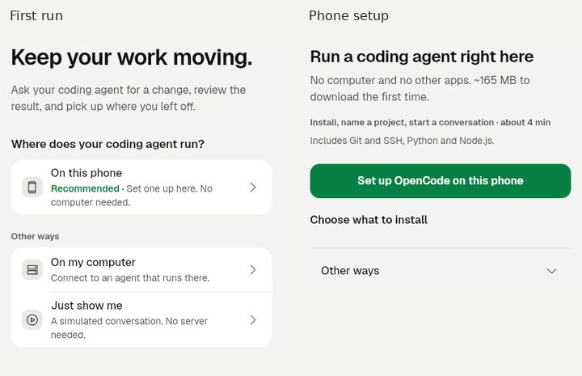

  After: the phone choice leads with Recommended, and setup lists its steps and estimated time; assembled crops of the same two existing light goldens. Sources: [servers_welcome_light.png](../../../test/goldens/servers_welcome_light.png), [phone_setup_start_fresh_light.png](../../../test/revamp/goldens/phone_setup_start_fresh_light.png).
