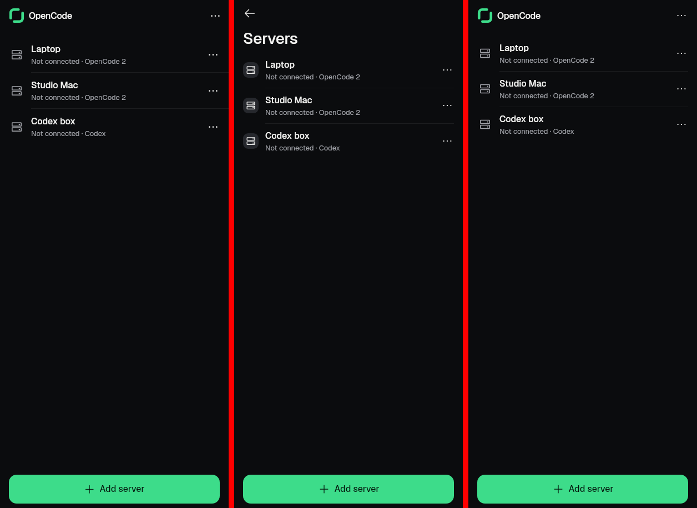
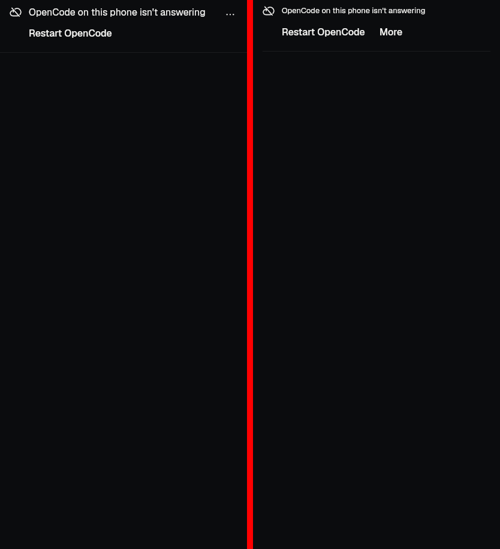
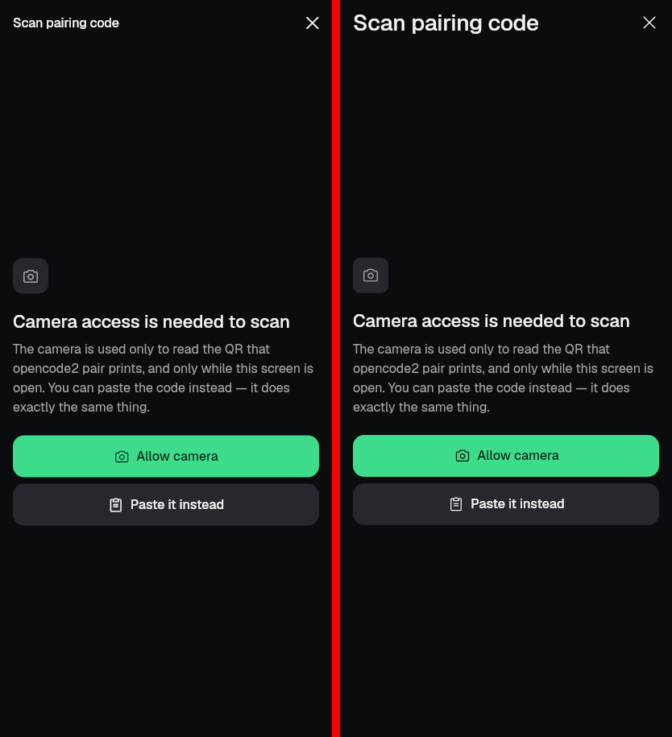

# Scoreboard groups I + J: `:ui:shell` (order 53) and `:feature:servers` (order 45)

Branch `native/s17-shell-servers` from `native/screens-merge22` (e6a10900e). Scoreboard: `SCOREBOARD-2026-11-07.md`
on `native/rb-score`, groups I and J.

## How it was measured (and what differs from the VPS gate)

- Gradle `desktopTest --tests '*.rb.o45.*'` / `'*.rb.o53.*'` in this container (JDK 21, Android SDK 37.1), then
  `RB_DEV=1 rb_gate.py evaluate --order NN` on the rows it wrote. The tracker post went to a dead port.
- **Golden source differs from the gate's.** FLUTTER_REF `8302de537` isn't in this clone, so the goldens in
  `looks-gate/flutter/8302de537/` were copied from `origin/master` (the released 2.1.4 app) by manifest path. A rerun of
  `gate_order.sh` on the VPS with the real ref is still needed before these numbers count.
- No `render.tsv` (it needs the Flutter test sources at the ref). The new gate cases pass their window, density and
  view ratio explicitly, so they don't depend on it. The existing order-45 cases used name defaults (412 x 915 @ 1).
- Static checks (`rb_gate.py static`) and the alignment gate were not run on their own. The layout guard runs inside
  every `FlutterGoldenGate.check`, and it passes with no new baseline entry for every shot here.

## Before / after

| Order | Goldens | Rendered before | Pass before | Rendered after | Pass after |
|---|---:|---:|---:|---:|---:|
| 45 servers | 155 | 14 | 0 | 14 | 0 |
| 53 shell | 50 | 0 | 0 | 22 | **16** |

Order 45 got closer without passing anything:

| Shot | Before | After |
|---|---|---|
| `servers_servers_loaded_dark` | blob 689, line moved 52.9 px, ink n/a | **blob 0**, line moved 4.1 px (max 2.5) |
| `servers_servers_loaded_light` | blob 199, moved 95.9 px | blob 0, moved 4.1 px |
| `servers_servers_loaded_1280x800_*` | blob 6,353-6,512 | unchanged in number: the residue is the row group (below) |
| `servers_pairing_scanner_*` | blob 174-203, ink 2.5-3.0×, moved 26-30 px | unchanged: the cause is in `:ui:kit` (below) |

## What changed

J1, servers root page (`b0b40c27e`, `4b5c17293`):
- `ServersScreen(root = true)` draws Flutter's root bar (`KitTopBar(brand: true)`, servers_state.dart:83-90): the mark,
  "OpenCode" in the headline page-title role, and a ⋯ menu. On PC windows it also draws the toolbar hairline. The bar
  is arranged from kit parts in `ServersBrandBar.kt`, because the kit `KitTopBar` has no `brand` flag. **Proposal for
  the kit owner (A8):** add `brand` to `KitTopBar` and delete `ServersBrandBar`.
- The root ⋯ offers Report a problem (`ServersActions.reportProblem` → `SettingsRoute.ReportProblem`). Flutter's About
  and Setup guide entries have no native route, so they're left out.
- **Not wired in the app.** Every native path pushes `ServersRoute.Home` (`RootDecision` never makes it the stack root),
  and `AppNavigator` can't say whether it can pop. So `ServersEntries` keeps the default `root = false`, and the app
  still shows Back + "Servers", which is Flutter's pushed look. Only the gate case renders the root scene.
- Saved-server rows draw a bare glyph in flat lists (kit_row.dart:994-998), with the connected server's glyph in the
  accent. Panel styles keep the tile.
- J3, the layout guard: "tight: Servers" no longer applies on the root shot. The ⋯ edge-tap finding the new bar raised
  is fixed: its target is held space1 from the edge. That costs 4 px against Flutter, whose ⋯ target touches the edge.

I, shell gate cases (`9375399a2`):
- `StatesScenesGateTest`: 8 scenes × 2 modes, **16/16 pass** (box ≤ 0.01 %, blob ≤ 1 px).
- `ConnectionLineGateTest`: the not-answering connection line (A07) renders `KitStatusLine` with
  `connectionKitStatus`'s inputs. All 6 shots are measured now and all fail, on the kit part:

## Left for other groups (outside `:ui:shell` and `:feature:servers`)

- **A8, `KitTopBar` title role.** This is the whole scanner difference (J2): every scanner shot differs only in the
  title, which is the 28 sp large title where Flutter uses the 17 sp headline, plus a ⋯/close glyph about 4 px further
  in. 
- **A6, `KitRowGroup` in flat lists.** The pitch is 64 dp where Flutter's is 65, because Flutter's hairline adds 1 px to
  each row. The first row also starts 2 px higher, and on wide windows the hairlines stop 16 px short of the trailing
  rail. That leaves the 4.1 px line shift on the phone shot and the wide residue.
- **`KitStatusLine`.** The message uses a small caption where Flutter uses the body size. More is a word on the action
  row where Flutter has a ⋯ at the line's top end. The hairline is inset where Flutter's runs full width.
- **The other 28 order-53 goldens** render feature screens: conversations, files, search, settings (`shell_reconnecting`
  is the settings hub), command palette, shortcuts help and question sheet. `:ui:shell` can't depend on
  `:feature:*` (module rules), so their gate cases belong to those modules' orders, or to an app-level gate module.
- **The other 141 order-45 goldens** (J4) still have no gate case.

## Pre-existing failure (not from this branch)

`:feature:servers` `PhoneOwnServerMarkTest` "B-NAV-040 the Servers screen marks only the phone's own server as This
phone" fails on `native/screens-merge22` with this branch's changes stashed, so it predates this work. Every other test
in both modules passes: servers 116/117, shell 52/52.
