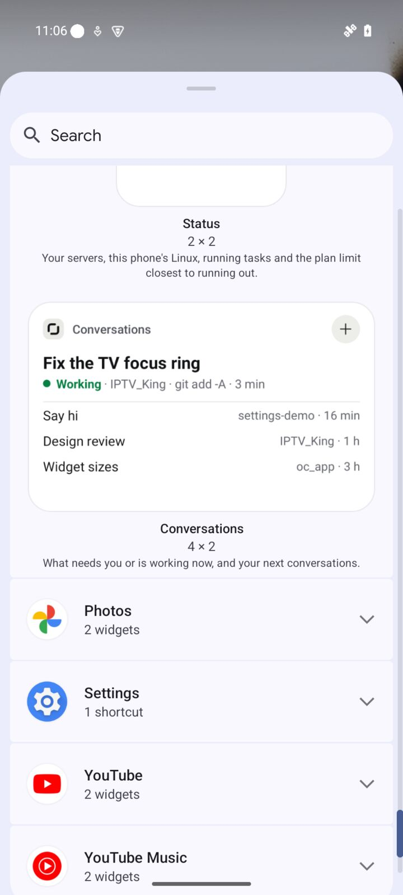
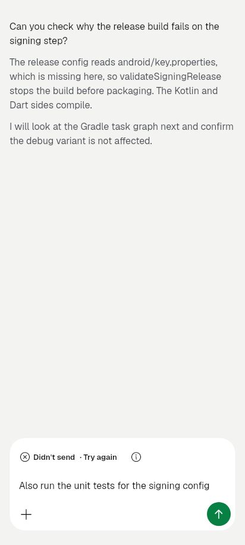

# OpenCode Mobile 2.1.0+57 — pictures

Each picture is one real phone screen from an Android emulator running the release candidate. Full notes: [v2.1.0+57.md](../v2.1.0+57.md).

## Highlights

**Two new home-screen widgets: Conversations and Status**

**Git from the chat**

**Inbox: everything that waits on you, in one list**

**A new Appearance: one question at a time**

**One Stop, always in the same place**

**See what is making the phone hot**

**Simplified Chinese for most of the app**

**Find anything from Search**

## Chat

**Work still running in the background is shown**

**Send later, or repeat, from a long press on Send**

**"No model signed in" before your first message**

## Appearance

**Five styles, with corners and spacing**

**Signal style**

**Signal style**

**Glass for the message box and header**

**Saver mode and named accent colours**

## Widgets

**Conversations (4×2) and Status (2×2) widgets**

## Settings

**Scheduled prompts can run every day at a set time**

## Chat

**Requests name the action, its target and what it touches**

**Model picker starts with three plain choices**

## New conversation

**Starting a conversation is one question**

## Appearance

**After you update: Solid style, moving background off**

## Widgets

**Conversation widgets are clearer**

## Notifications

**Notifications read as a question or a plain result**

## This phone

**This phone opens on one plain answer**

**The server list says each server's real state**

## AI Team

**The AI Team merge is one question card**

## Setup

**Setup shows one progress ring**

## Settings

**Settings opens on a search and five groups**

**Report a problem knows what went wrong**

## Chat

**Stopped and failed replies say what really happened**

**A failed send says why and gives your words back**

## Linux on the phone

**Programs left behind by a stopped Linux are ended**

